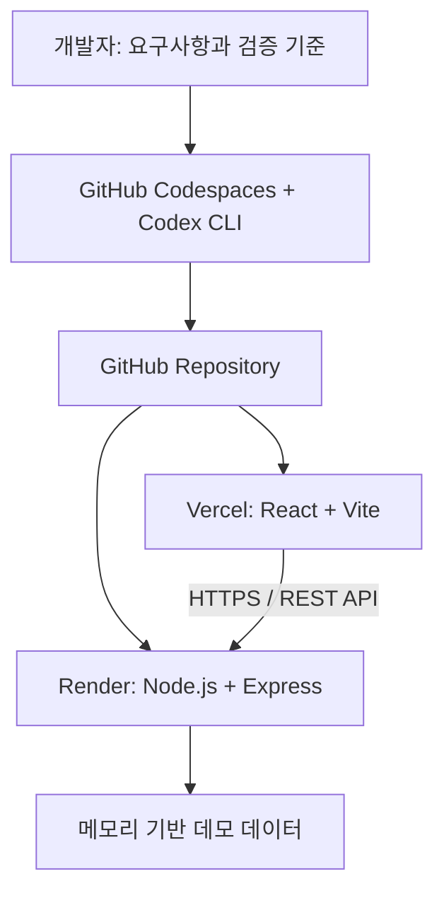

> **세종사이버대학교 AI응용소프트웨어공학과 온라인 특강 \| 2026년 10월**
> 강사: 김범준 \| 총 90분 이내 \| 스튜디오 녹화형 \| 이론과 개발·배포 시연
# 특강 개요
**제목:** 생성형 AI와 바이브 코딩: AI 기반 웹 서비스 설계부터 개발·배포까지
**핵심 주제:** AI 코딩 에이전트와 개발자가 협력하여 요구사항을 정리하고, React·Node.js(Express) 기반의 **중고차 매물 관리 CRUD 프로토타입**을 개선·검증한 뒤 GitHub·Render·Vercel에 배포하는 전 과정을 소개합니다.
**강의 대상:** AI응용소프트웨어공학과 학생 및 AI 기반 소프트웨어 개발에 관심 있는 학습자. JavaScript, 웹 브라우저, HTTP/JSON 기초를 알면 도움이 되지만 이론은 입문자도 이해하도록 구성했습니다.
**강의 형태:** 학생 참여 없이 진행하는 녹화 강의. 설치·인증·초기 클라우드 배포는 촬영 전에 완료하고, 녹화 중에는 AI를 이용한 핵심 변경·검증·자동 배포 확인에 집중합니다.
**교재 상태:** GitHub 저장소에 코드·자동 API 테스트·React 빌드 워크플로를 등록했습니다. GitHub Actions의 실제 성공 여부는 Actions 이력에서 확인합니다. Codespaces·Render·Vercel의 실제 통합 배포, 학교 PPT 템플릿, 계정 인증 및 스튜디오 촬영은 별도 검증이 필요합니다.
**실습 GitHub:** [comstudynews/ai-vibe-coding-2026](https://github.com/comstudynews/ai-vibe-coding-2026) 본문은 검증하지 않은 결과를 성공했다고 기술하지 않습니다.
# 학습목표
① 바이브 코딩과 AI 보조 소프트웨어 개발의 차이를 설명합니다.
② 위젯·컴포넌트·레이아웃과 PoC·Prototype·MVP·Pilot의 목적을 구별합니다.
③ 프롬프트·컨텍스트·하네스 엔지니어링을 하나의 개발 사례에 적용합니다.
④ Codespaces와 Codex CLI가 각각 어떤 역할을 하는지 설명합니다.
⑤ React 화면과 Express CRUD API가 REST/JSON으로 연결되는 구조를 이해합니다.
⑥ GitHub에서 Render·Vercel로 이어지는 자동 배포와 CI/CD의 관계를 구별하고, 구현 결과의 한계를 판단합니다.
# 90분 운영 계획

| 구분 | 세부 주제 | 시간 |
| --- | --- | --- |
| 도입 | 완성 앱 소개, 수업 목표 | 3분 |
| 이론 1 | 생성형 AI, 바이브 코딩, 위젯·레이아웃 | 9분 |
| 이론 2 | PoC·Prototype·MVP·Pilot | 7분 |
| 이론 3 | 프롬프트·컨텍스트·하네스 엔지니어링 | 10분 |
| 이론 4 | GitHub Codespaces·Codex CLI | 6분 |
| 이론 5 | React·Express·GitHub·Vercel·Render·DevOps/CI/CD | 7분 |
| 시연 1 | Codespace·Codex 시작, 구조 분석 | 5분 |
| 시연 2 | React UI 수정과 CRUD 기능 시연 | 12분 |
| 시연 3 | Express API 연동과 API 검증 | 8분 |
| 시연 4 | Git 검토·Push·Render/Vercel 자동 배포 확인 | 12분 |
| 정리 | 배포 결과·MVP 확장 과제·한계 | 5분 |
| 예비 | 재실행·로그인·빌드 지연 대응 | 6분 |
| **합계** | **녹화용 상한** | **90분** |

# 교재 목차
아래 하위 페이지를 순서대로 학습합니다.
1. 제1장. 생성형 AI·바이브 코딩과 소프트웨어 기획
2. 제2장. 프롬프트·컨텍스트·하네스 엔지니어링
3. 제3장. GitHub Codespaces·Codex CLI 개발 환경
4. 제4장. 중고차 CRUD 웹 앱 구현과 검증
5. 제5장. GitHub·DevOps·Vercel·Render 배포
6. 제6장. 90분 촬영 시나리오·점검표·PPT 설계

# 최종 구현 구조

> **구현 범위:** 이번 앱은 서버 재시작 시 데이터가 사라지는 **프로토타입**입니다. 실제 사용자 대상 MVP로 소개하지 않습니다. 인증·영구 저장·접근 통제·보안·운영 지표를 보완한 뒤 제한된 사용자에게 파일럿으로 제공해야 합니다.
# 참고 교안 및 공식 문서
**사용자 제공 교안(내용의 출처):**
- 「생성형 AI와 바이브 코딩」 1주차 PDF: 생성형 AI 및 바이브 코딩 개념
- 「뽀모도로 타이머 앱 개발」 6주차 PDF: UI 기획·MVP·PoC·Prototype·Pilot
- 「GitHub Codespaces에서 Codex CLI 사용 방법」 6쪽 PDF: Codespaces, CLI 설치·인증·실행 절차
- 「01. (PC기반)SpringAI_실습_VSCode_OpenAI_React_Cloud」 58쪽 PDF: React/Vite, CORS, 환경변수, Render·Vercel 및 보안·배포 검증
- 유영진 교수 「OpenAI API로 작성하는 스마트 회의 보고서」 73쪽 PDF: 온라인 특강 슬라이드의 설명 방식 참고(원본 슬라이드·이미지 재사용 금지)
**2026년 10월 공식 자료 재확인용 링크:**
- [GitHub Codespaces 개요](https://docs.github.com/en/codespaces/overview)
- [Codespaces 포트 전달](https://docs.github.com/en/codespaces/developing-in-a-codespace/forwarding-ports-in-your-codespace)
- [OpenAI Codex CLI 공식 저장소](https://github.com/openai/codex)
- [Render Web Services](https://render.com/docs/web-services)
- [Render 무료 서비스 제한](https://render.com/docs/free)
- [Vercel Monorepo 배포](https://vercel.com/docs/monorepos)
- [Vercel 서비스 이용약관](https://vercel.com/legal/terms)
**편집 주의:** 대학교 공식 로고·템플릿은 제공받은 원본을 사용합니다. 참고 PDF의 타 교수 제작 이미지와 슬라이드는 허락 없이 복제하지 않습니다. 플랫폼 요금·UI·설정은 촬영 직전 다시 확인합니다.
