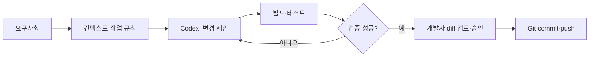

> **이론 3 \| 강의 약 10분** — 같은 CRUD 기능을 지시하는 세 가지 AI 개발 엔지니어링 접근
# 제2장. 프롬프트·컨텍스트·하네스 엔지니어링
## 2.1 학습목표
① 프롬프트·컨텍스트·하네스 엔지니어링의 역할을 구분합니다.
② AI에게 요구사항과 기존 프로젝트 정보를 분리해 전달합니다.
③ 코드 변경이 정상인지 판단할 검증 절차를 정의합니다.
## 2.2 세 개념의 관계

| 구분 | 설명 | 실습 적용 |
| --- | --- | --- |
| 프롬프트 엔지니어링 | 목표·제약·원하는 출력 형식을 명료하게 지시하는 활동 | 매물 등록 기능을 추가하고 오류 상태를 표시하라고 요청 |
| 컨텍스트 엔지니어링 | 작업에 필요한 코드·명세·규칙·참고 자료를 선택·유지·전달하는 활동 | 폴더 구조, 기존 API, 차량 데이터 형식, 변경 금지 범위 제공 |
| 하네스 엔지니어링 | AI가 작업할 환경, 도구·권한·제약·검증·반복 개선의 체계를 설계하는 실천 | [AGENTS.md](http://AGENTS.md), 테스트, 빌드, diff 검토, 승인 절차 |

이 구분은 이해를 돕기 위한 것이며 실무에서 세 활동은 겹치고 반복됩니다. 특히 **하네스 엔지니어링**은 적용 범위가 조직·도구에 따라 달라지는 비교적 새로운 실무 용어입니다.
## 2.3 프롬프트 엔지니어링
### 2.3.1 불완전한 지시
> 중고차 사이트 예쁘게 만들어 줘.
이 요청에는 사용자의 역할, 반드시 필요한 기능, 기술 스택, 검증 기준이 없습니다.
### 2.3.2 개선한 지시
```plain text
현재 React·Express 기반 중고차 매물 관리 프로젝트를 수정하세요.
목표: 차량명·연식·주행거리·가격을 등록할 수 있는 폼을 추가합니다.
제약: 기존 GET /api/cars 기능과 폴더 구조를 유지하세요.
입력 검증: 차량명 공백 금지, 가격·주행거리 0 이상.
출력: 먼저 수정 대상 파일과 구현 계획을 설명하세요.
검증: npm run build와 API 테스트 방법을 제시하세요.
제한: 내 승인 전에는 파일을 수정하지 마세요.
```
**좋은 프롬프트의 기본 구조:** 역할/맥락 → 목표 → 입력·출력 → 제약 → 완료 기준 → 검증 방식.
## 2.4 컨텍스트 엔지니어링
### 2.4.1 코드를 작성하기 전에 AI가 알아야 할 사실
- 기존 구조는 client(React + Vite), server(Express)입니다.
- API 주소는 개발 시 /api 프록시, 배포 시 VITE_API_BASE_URL입니다.
- 차량 데이터는 id, name, year, mileage, price입니다.
- 현재 단계는 데이터베이스 없는 프로토타입입니다.
- 보안·인증 기능은 구현하지 않았으므로 공개 실서비스로 홍보하지 않습니다.
잘못된 컨텍스트는 잘못된 결정을 유도합니다. 프로젝트 전체를 무조건 AI에게 던지는 것보다 **관련 파일과 인터페이스만 정확히 제공**하는 편이 효과적입니다.
### 2.4.2 작업 전 분석 요청
```plain text
현재 저장소를 읽고 다음 항목을 분석한 후 보고하세요.
1. 전체 폴더 구조와 실행 스크립트
2. 기존 CRUD API 및 프론트엔드 연결 구조
3. 환경변수·CORS·포트 설정
4. 테스트 실행 명령
5. API 키·개인정보·과도한 도구 권한 위험
아직 파일을 수정하지 마세요. 확인한 사실과 추측을 구분하세요.
```
## 2.5 하네스 엔지니어링
AI가 코드를 작성하는 환경과 작업 규칙을 설계하고, 결과를 실행하여 확인하는 반복 구조가 핵심입니다.

### 2.5.1 [AGENTS.md](http://AGENTS.md) 예제
프로젝트 루트에 AI 작업 원칙을 적어 두는 예제입니다. `AGENTS.md`는 AI에게 제공하는 **지침 파일**이지, 운영체제 파일 권한이나 명령 실행을 강제로 통제하는 보안 장치가 아닙니다. 하네스 설계에는 실행 환경, 샌드박스·도구 권한, 명시적 승인 절차, 자동 테스트와 사람의 최종 검토를 함께 포함해야 합니다.
```markdown
# AGENTS.md — 중고차 CRUD 데모
## 프로젝트 범위
- client/: React + Vite
- server/: Node.js + Express
- 저장 방식: 서버 메모리. 데이터베이스 추가 금지.

## 작업 규칙
- 기존 API 경로(/api/cars)를 임의로 변경하지 않는다.
- 변경 전에 작업 계획과 대상 파일을 보고한다.
- 요구받지 않은 패키지와 의존성은 추가하지 않는다.
- API 키·비밀번호·개인정보는 코드에 기록하지 않는다.
- 공개 배포 전에는 접근 통제의 부재를 경고한다.

## 완료 기준
- client에서 npm run build 성공
- GET /health 200 확인
- 비공개 개발 환경에서 GET/POST/PUT/DELETE /api/cars 동작 확인
- 공개 배포 환경에서 POST/PUT/DELETE가 403인지 확인
- 빈 문자열, null, 음수, 소수 등 잘못된 입력에서 400 응답 확인
- git diff에서 의도하지 않은 변경이 없음
```
### 2.5.2 실행과 검증
```bash
# 프론트엔드 빌드
cd client && npm run build
# 서버 테스트는 별도 터미널에서 수행
curl -i http://localhost:3000/health
curl -i http://localhost:3000/api/cars
# Git 변경 확인
git status
git diff --check
git diff
```
GitHub 저장소의 `server/test/app.test.js`에서는 CRUD와 입력 검증·읽기 전용 차단을 자동 테스트합니다. 명령이 성공했다고 기능·보안 전체가 검증된 것은 아닙니다. API 의미 검증, 예외 입력, UI, 데이터 보존, 접근 권한은 각기 별도로 확인합니다.
## 2.6 개발자가 최종 책임을 지는 영역
① AI가 수정한 파일과 변경 의도를 검토합니다.
② 프로젝트 비밀값을 화면·로그·Git 기록에 남기지 않습니다.
③ 테스트 통과와 실사용 승인 여부를 혼동하지 않습니다.
④ 승인되지 않은 명령 실행·외부 배포·데이터 삭제를 허용하지 않습니다.
## 2.7 정리
- 프롬프트는 **무엇을 해 달라고 말하는가**입니다.
- 컨텍스트는 **무슨 정보를 보고 판단하는가**입니다.
- 하네스는 **어떤 환경에서 안전하게 작업하고 검증하는가**입니다.
**강의자 메모:** 이 세 가지를 서로 무관한 개념으로 설명하지 말고, '중고차 등록 버튼 하나 추가하기' 사례로 순차 비교한 후 마지막에 상호 반복된다고 정리합니다.
