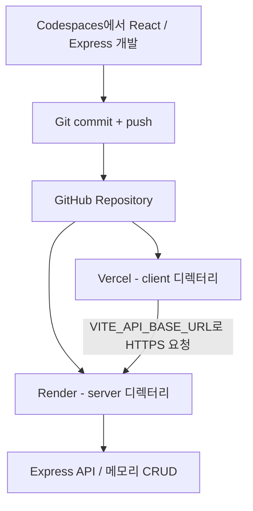

> **이론 5 + 배포 시연 \| 이론 약 7분·시연 약 12분** — GitHub·Vercel·Render 역할 및 배포 전·후 검증
# 제5장. GitHub·DevOps·Vercel·Render 배포
## 5.1 학습목표
① Git, GitHub, CI, CD, DevOps의 역할을 구분합니다.
② React와 Express를 하나의 저장소에 담아 각 플랫폼에 배포합니다.
③ 배포 전 보안·환경변수·CORS·서버 포트를 설정합니다.
④ 배포 성공과 애플리케이션 기능 성공을 구별합니다.
## 5.2 DevOps·CI/CD 개념
**DevOps:** 개발·운영 사이의 협력, 변경 자동화, 빠른 피드백, 운영 안정성을 중시하는 실천 방식입니다.
**Git:** 작업 파일의 변경 이력을 로컬 저장소에 기록하는 버전 관리 도구입니다.
**GitHub:** 원격 저장소, 코드 검토, 이슈, 자동화 기능 등을 제공하는 협업 플랫폼입니다.
**CI (Continuous Integration):** 변경된 코드를 자주 통합하고 자동 빌드·테스트 등으로 문제를 빠르게 확인하는 방식입니다.
**CD (Continuous Delivery / Deployment):** 검증된 변경을 배포 가능한 상태로 유지하거나 실제 배포하는 자동화 방식입니다.

| 행위 | 무엇을 보여 주는가? | 오해하면 안 되는 점 |
| --- | --- | --- |
| git add/commit/push | 버전 관리와 원격 저장소 반영 | Push 자체는 테스트·배포가 아님 |
| GitHub Actions 빌드·테스트 | CI의 예 | 테스트를 구성하지 않으면 자동화된 CI라 하기 어려움 |
| Render·Vercel 자동 배포 | Git 연동 CD의 예 | 자동 배포만으로 DevOps 전체나 완전한 CI/CD가 아님 |
| 배포 로그·헬스 체크·기능 검증 | 운영 검증의 기초 | HTTP 200만으로 보안과 품질을 보증하지 못함 |

## 5.3 배포 아키텍처

**이번 예제:** React는 Vercel 정적 사이트, Express는 Render Node Web Service에서 실행합니다. Render에는 NODE_ENV=production을 설정하여 외부 변경 요청을 차단하고, 실제 CRUD는 비공개 Codespaces에서 수행합니다. Spring AI·Docker를 사용하는 이전 PDF의 예제를 React·Express 특강에 그대로 혼합하지 않습니다.
## 5.4 1단계 — GitHub 등록 전 검토
```bash
# 저장소 최상위에서
git status
git diff --check
git diff
```
기밀 파일 제외용 **.gitignore** 예:
```plain text
**/node_modules/
**/dist/
.env
.env.*
!.env.example
*.log
.DS_Store
```
실습은 API 키가 필요 없는 CRUD 예제입니다. 향후 LLM API를 연결하더라도 비밀키는 반드시 백엔드 비밀 설정에 저장해야 합니다.
Git 변경 사항을 사람 눈으로 검토한 뒤:
```bash
git add .
git commit -m "Prepare used-car demo for cloud deployment"
git push origin main
```
**참고:** 새로운 저장소에서 최초 Push를 수행할 때는 원격 저장소가 이미 연결되어 있어야 합니다. Codespaces는 GitHub 저장소에서 생성했으므로 보통 연결이 되어 있습니다.
## 5.5 2단계 — Render에 Express 백엔드 배포
① Render 대시보드에서 **New → Web Service**로 진입합니다.
② GitHub 저장소 `comstudynews/ai-vibe-coding-2026`를 연결합니다.
③ Runtime: **Node**, Root Directory: **server**
④ Build Command: **npm install**
⑤ Start Command: **npm start**
⑥ Health Check Path: **/health**
⑦ GitHub main 브랜치 자동 배포 활성화
⑧ Render 환경변수 **NODE_ENV=production**, **APP_CORS_ALLOWED_ORIGINS=**[**https://실제-프론트.vercel.app**](https://실제-프론트.vercel.app) 설정
이번 실습 저장소에는 package-lock.json을 아직 포함하지 않았으므로 `npm ci`가 아니라 `npm install`을 사용합니다. 이후 Codespaces에서 의존성 설치 후 잠금 파일을 커밋하면 `npm ci`로 전환할 수 있습니다.
Express 서버는 `server/index.js`에서 `process.env.PORT`와 `0.0.0.0`을 사용합니다. `NODE_ENV=production`인 공개 Render 환경에서는 보안상 **조회 전용**입니다.
```bash
curl -i https://YOUR-BACKEND.onrender.com/health
curl -i https://YOUR-BACKEND.onrender.com/api/config
curl -i https://YOUR-BACKEND.onrender.com/api/cars
```
기대: `/health`는 200, `/api/config`는 `{"readOnly":true}`, `/api/cars`는 200. POST/PUT/DELETE는 403입니다.
## 5.6 3단계 — Vercel에 React 배포
① Vercel 대시보드에서 **Add New → Project**로 진입합니다.
② GitHub 저장소를 Import합니다.
③ Root Directory: **client**
④ Framework Preset: **Vite**
⑤ Build Command: **npm run build**
⑥ Output Directory: **dist**
⑦ Environment Variables: **VITE_API_BASE_URL=**[**https://YOUR-BACKEND.onrender.com**](https://YOUR-BACKEND.onrender.com)
⑧ 배포 후 Vercel 프론트엔드 URL을 확인합니다.
**핵심:** `VITE_` 접두사 환경변수는 빌드 결과의 브라우저 코드에 포함될 수 있습니다. 공개 가능한 API **주소**는 넣을 수 있지만 API 키·토큰·DB 비밀번호를 넣으면 안 됩니다.
## 5.7 4단계 — CORS와 배포 연결
배포 순서는 다음처럼 관리합니다.
① Render 백엔드를 배포해 주소를 확보합니다.
② Vercel의 VITE_API_BASE_URL에 Render 주소를 등록해 프론트엔드를 배포합니다.
③ Vercel에 생성된 실제 Origin을 Render의 APP_CORS_ALLOWED_ORIGINS에 등록합니다.
④ Render에서 서비스 재배포 또는 설정 반영을 완료합니다.
⑤ 시크릿 브라우저 창에서 Vercel 웹앱을 열고 매물 **목록 조회·검색**을 확인합니다. 공개 Render에서는 `GET /api/cars` 200, `GET /api/config` `{"readOnly":true}`, POST·PUT·DELETE 403을 각각 확인합니다. 전체 CRUD는 비공개 Codespaces에서만 시연합니다.
**Origin 예시:** [https://your-demo.vercel.app](https://your-demo.vercel.app) (맨 끝 슬래시 없음).
CORS는 브라우저의 교차 출처 읽기를 제어하는 정책입니다. **인증·인가를 대신하지 않으므로**, CORS로 허용되지 않은 도구나 서버에서의 직접 HTTP 요청까지 막을 수 있는 것은 아닙니다.
## 5.8 5단계 — 개발 환경과 공개 배포를 구분한 통합 검증
**비공개 Codespaces 개발 환경:**
- [ ] React 화면에서 차량 등록(201)·조회(200)·수정(200)·삭제(204)를 시연합니다.
- [ ] 빈 문자열·null·음수 등의 잘못된 입력은 400입니다.
- [ ] 존재하지 않는 ID는 404입니다.
**공개 Render·Vercel 환경:**
- [ ] Vercel URL에 React 매물 목록이 표시됩니다.
- [ ] `GET /api/config` 응답이 `{"readOnly":true}`입니다.
- [ ] `GET /api/cars`는 200이고 브라우저 CORS 오류가 없습니다.
- [ ] POST/PUT/DELETE 요청은 403으로 차단됩니다.
- [ ] GitHub Push 이후 GitHub Actions의 API 테스트·React 빌드와 Render·Vercel의 Git 연동 배포 결과를 **각각** 확인합니다. 현재 저장소에서 CI 통과는 배포를 강제적으로 제어하는 승인 게이트가 아닙니다.
- [ ] 환경변수에 비밀 정보가 없고 로그에 계정 비밀값이 노출되지 않습니다.
**원칙:** 서버에 사용자 인증이 없다면 공개 클라우드에서 쓰기 가능한 CRUD를 그대로 제공하지 않습니다.
## 5.9 GitHub Actions를 이용한 자동 API 테스트 및 React 빌드
이번 저장소에는 다음 GitHub Actions 워크플로가 실제로 추가되어 있습니다.
파일: **.github/workflows/ci.yml**
```yaml
name: check
on:
  push:
    branches: [main]
  pull_request:

jobs:
  test:
    runs-on: ubuntu-latest
    steps:
      - uses: actions/checkout@v4
      - uses: actions/setup-node@v4
        with:
          node-version: '24'
      - name: Install server dependencies
        working-directory: server
        run: npm install --no-audit --no-fund
      - name: API tests
        working-directory: server
        run: npm test
      - name: Install client dependencies
        working-directory: client
        run: npm install --no-audit --no-fund
      - name: React build
        working-directory: client
        run: npm run build
```
이 작업은 서버 의존성을 설치한 뒤 **Node.js 내장 테스트 러너로 CRUD·입력값·읽기 전용 차단을 검증**하고, React 클라이언트를 빌드합니다.
단, 자동화된 API 테스트와 빌드가 통과하더라도 Vercel·Render 통합 배포, 보안, 실제 UX까지 보장하지는 않습니다. GitHub Actions 실행 결과는 [2026-10-14 성공 이력](https://github.com/comstudynews/ai-vibe-coding-2026/actions/runs/38520612469)에서 확인할 수 있습니다.
## 5.10 서비스 이용 조건과 운영상 위험
> **요금제 및 배포 권한:** Vercel Hobby 무료 플랜은 개인·비상업적 사용으로 제한됩니다. 유료 특강과 연결된 배포는 해당 제한의 적용 가능성이 있으므로, 촬영용 배포에는 대학에서 승인한 적절한 플랜·계정 또는 사용 조건에 부합하는 대안을 선택해야 합니다. 무료 플랜을 무조건 사용할 수 있다고 안내하지 않습니다.
Render Free 웹 서비스는 일정 유휴 시간 후 중지될 수 있으며 재시작 시 대기가 발생합니다. 로컬 파일과 메모리 저장 내용도 지속적인 보존이 보장되지 않습니다. **촬영 전에 서비스 호출을 준비**하고, 배포가 지연될 경우 미리 확보한 정상 화면을 보여 줍니다.
**공개 보안 조치:** 인증·인가가 없는 현재 API를 `NODE_ENV=production`으로 배포하면 쓰기 작업(POST/PUT/DELETE)이 403으로 차단됩니다. 강의에서는 **비공개 Codespaces 전체 CRUD + 공개 Render/Vercel 조회 및 배포**를 구분합니다. CORS는 인증을 대체하지 않습니다.
## 5.11 자주 발생하는 오류

| 문제 | 우선 확인 |
| --- | --- |
| Render 빌드 실패 | Root Directory=server, npm install(잠금 파일 미포함 단계), package.json |
| Render 서비스 접속 불가 | PORT 및 0.0.0.0 바인딩, 로그, 무료 서비스 재시작 |
| Vercel 배포 실패 | Root Directory=client, npm run build, dist |
| 브라우저 CORS 오류 | 실제 Vercel Origin과 Render 허용 출처 일치 |
| Failed to fetch | HTTPS Render URL, 백엔드 가용성, VITE_API_BASE_URL |
| 데이터 초기화 | 서버 재시작·재배포·메모리 저장의 특성 |

## 5.12 정리
Git과 GitHub가 변경 이력을 관리하고, Render·Vercel이 Git 저장소 변경을 바탕으로 배포를 수행하며, 프론트엔드와 API는 HTTPS로 통신합니다. **배포 성공은 출발점일 뿐 기능·보안·운영 검증을 대체하지 않습니다.**
**공식 자료:** [Render Express 배포](https://render.com/docs/deploy-node-express-app) · [Render 무료 서비스](https://render.com/docs/free) · [Vercel Monorepo](https://vercel.com/docs/monorepos) · [Vercel 이용약관](https://vercel.com/legal/terms)
